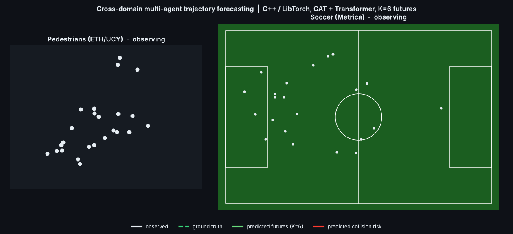

# Cross-Domain Multi-Agent Trajectory Forecasting

A full training + inference pipeline, written in C++ with LibTorch, that forecasts
multi-agent future trajectories (pedestrians, soccer players) from past positions —
using a shared graph-attention + transformer encoder trained across two very
different domains at once.



*Left: real pedestrians, ETH/UCY benchmark. Right: a real soccer match, Metrica
Sports tracking data. One model, one checkpoint, forecasting both — white = observed
4s of motion, green dashed = what actually happened, colored fans = the model's 6
predicted futures, red = predicted collision risk between agents.*

## Why this exists

Pedestrian trajectory forecasting (the kind self-driving cars need) and sports
player tracking are structurally the same problem: many interacting agents, each
with a short history of 2D positions, moving under social/physical constraints.
This project tests whether a model can learn transferable multi-agent motion
patterns across that domain gap — and, just as importantly, diagnoses *why* it
might fail to.

## Architecture

- **Spatio-temporal encoder**: a dense Graph Attention Network (edge features =
  relative position, distance, closing speed) per timestep, followed by a
  Transformer over time, pooled at each agent's last valid frame.
- **Multi-modal decoding head**: K=6 learned trajectory anchors, EWTA
  (Evolving Winner-Takes-All) regression loss with k-annealing, mode
  classification + diversity regularization.
- **Domain-adversarial training**: a gradient-reversal domain classifier
  (Ganin & Lempitsky / DANN) pushes the encoder toward domain-invariant
  features, with a sigmoid lambda ramp.
- **Collision risk scoring**: geometric, not learned — minimum pairwise
  distance over the probability-weighted expected future path of each pair
  of agents.

All of it is hand-written in C++ against LibTorch 2.1 + CUDA 11.8, including a
custom `torch::autograd::Function` for gradient reversal, a dense GAT layer,
and the training loop — no Python at train/inference time.

## Honest results (the part that actually matters)

| Setting | Pedestrian ADE | Pedestrian FDE |
|---|---|---|
| Pedestrian-only baseline (trained only on ETH/UCY) | **0.634 m** | **1.056 m** |
| Mixed-domain (50/50 pedestrian+soccer, naive) | ~1.03–1.04 m | ~1.47–1.58 m |

Naively mixing the two domains made pedestrian forecasting **worse**, not
better — a textbook negative-transfer result. Rather than hide this, I dug
into *why*.

### Diagnosing the domain leak

A domain classifier trained adversarially on the shared encoder features
should, if the encoder is doing its job, end up near chance level at telling
pedestrian scenes from soccer scenes apart. Instead I compared it against the
dumbest possible baseline — a single threshold on raw agent count per scene:

| Classifier | Scene-level domain accuracy |
|---|---|
| Trivial agent-count threshold | **96.9%** |
| Learned domain classifier (adversarially trained) | 51.3% (≈ chance) |

The *trivial* count-based rule separates the domains almost perfectly —
soccer scenes simply have far more agents per scene than pedestrian scenes.
That's a structural shortcut the model can exploit that has nothing to do
with genuine motion-pattern differences, and it's the most likely real cause
of the negative transfer above, not an architecture or hyperparameter
failure.

**Fix attempted**: density-matching (subsampling soccer scenes down to
pedestrian-like agent counts before each batch) plus a loss that balances
per-scene-then-per-domain rather than per-agent (so soccer's extra agents
don't dominate the gradient). *[Fill in final epoch-200 pedestrian ADE/FDE
here once that run finishes, compared against the 0.634/1.056 baseline above.]*

## Repo layout

```
include/, src/     C++ source (graph construction, GAT+Transformer encoder,
                   domain-adversarial head, multi-modal decoding head, losses,
                   real-data loaders for ETH/UCY and Metrica Sports, training loop)
checkpoints/       small (<1MB) trained model weights
videos/            rendered results
CMakeLists.txt     LibTorch build config
```

## Building

Requires LibTorch 2.1+cu118 and CUDA 11.8.

```bash
cmake -S . -B build -DCMAKE_PREFIX_PATH=/path/to/libtorch -DCMAKE_CUDA_ARCHITECTURES=86
make -C build -j$(nproc)
```

## Data

- [ETH/UCY pedestrian benchmark](https://github.com/inhwanbae/GPGraph) (standard preprocessed split)
- [Metrica Sports sample tracking data](https://github.com/metrica-sports/sample-data)

Not included in this repo (see `.gitignore`) — clone them separately and point
`train` at their paths.

## License

MIT
